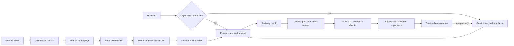

# DocuMind AI

[Public GitHub repository](https://github.com/RishabhYAdav123/DocuMind-AI-Multi-Document-RAG)

**Assignment 3 — Intelligent Multi-Document RAG System**

Ask intelligent questions across your documents. DocuMind is a local Streamlit application that indexes multiple PDF reports with Sentence Transformers and FAISS, retrieves page-level evidence, and asks Google Gemini for a structured, cited answer. Conversation-aware query reformulation supports follow-ups such as “What about 2024?”

## What is included

- Multiple PDF upload, byte-hash deduplication, size/page/collection limits and actionable parsing errors.
- Original extracted text, conservative normalization and recursive, page-local overlapping chunks.
- CPU embeddings, cosine retrieval, configurable top-k and relevance cutoff.
- Gemini integration with credentials from environment, structured outputs, timeout and bounded retry.
- Per-claim source IDs and exact quote validation; filenames and pages come from trusted metadata.
- Bounded session-specific chat, source expanders, document explorer and clear controls.
- Three original fictional reports, 25 labeled evaluation cases, offline tests and measured retrieval artifacts.

## Quick start on Windows

Use Python 3.11 or newer (validated environment: Windows x64, Python 3.12.7). Open PowerShell in this directory:

```powershell
python -m venv .venv
.\.venv\Scripts\python.exe -m pip install -r requirements.txt
Copy-Item .env.example .env
notepad .env
.\.venv\Scripts\python.exe -m streamlit run app.py
```

Set `GOOGLE_API_KEY` in `.env` to a key from [Google AI Studio](https://aistudio.google.com/). Keep it private. Set `LLM_MODEL` to a text-generation model available to your account. The configured default, `gemini-3.5-flash-lite`, was listed as stable in the [official model catalog](https://ai.google.dev/gemini-api/docs/models) checked on 13 November 2026. Account access and later model retirement are not guaranteed. Restart Streamlit after changing `.env`.

You may activate the virtual environment with `.\.venv\Scripts\Activate.ps1`; the commands above avoid PowerShell activation-policy issues. Open http://localhost:8501. First indexing downloads public embedding weights from Hugging Face into `.cache/models/` in the project. Subsequent runs reuse these weights. A GPU is not required. Allow several GB of disk space for Python dependencies and the model cache.

`requirements.txt` bounds the direct dependencies; `requirements-lock.txt` records the exact environment used for verification. For the closest reproduction on Windows/Python 3.12, install the lock file instead. Do not assume the lock is portable to every operating system or future Python version.

## Try the sample collection

Click **Try three sample reports**, wait for all three success messages, then ask:

1. “What was Northstar Analytics revenue in 2023?” Expected dataset fact: USD 12 million (annual report, p. 1).
2. “What about 2024?” Expected: USD 15 million from the same page.
3. “What funding did Aurora receive, and how many pilot customers did it have?” Expected: USD 1.2 million (annual p. 2), 30 customers (operations p. 2).
4. “Do the reports agree on the 2024 on-time delivery rate?” Expected discrepancy: 96% (annual p. 3) versus 94% (operations p. 1).
5. “What is the CEO's salary?” Expected abstention.

These are gold dataset examples, not claimed recordings of live Gemini outputs. All companies, figures and policies are fictional. See [sample origins](sample_documents/README.md).

## Architecture



Details: [architecture](docs/architecture.md), [methodology](docs/methodology.md), [case study](docs/project_report.md).

## Configuration

| Variable | Default | Purpose |
|---|---|---|
| `LLM_PROVIDER` | `gemini` | Only implemented provider |
| `GOOGLE_API_KEY` | empty | Local secret; needed for answers and rewriting |
| `LLM_MODEL` | `gemini-3.5-flash-lite` | Account-supported model ID |
| `EMBEDDING_MODEL` | `sentence-transformers/all-MiniLM-L6-v2` | Same encoder for documents and queries |
| `TOP_K` | 5 | Maximum retrieved chunks |
| `MIN_SIMILARITY` | 0.30 | Cosine cutoff, not calibrated confidence |
| `CHUNK_SIZE` / `CHUNK_OVERLAP` | 1000 / 200 | Characters, page-local |
| `MAX_FILE_MB` / `MAX_PAGES` | 20 / 500 | Per-document limits |
| `MAX_DOCUMENTS` / `MAX_CHUNKS` | 20 / 10000 | Session collection limits |
| `HISTORY_TURNS` | 6 | Stored turns and bounded rewrite context |
| `TIMEOUT_SECONDS` | 45 | Per provider attempt; one retry |
| `LLM_MIN_INTERVAL_SECONDS` | 0 | Optional per-service request pacing; evaluation uses 6 seconds |

The Streamlit upload cap is also 20 MB in `.streamlit/config.toml`; update both limits if necessary. Clear documents and re-index after changing embeddings or chunk parameters. Sidebar retrieval controls apply to subsequent questions.

## Citations and reliability

The LLM returns claims with source IDs and verbatim evidence quotes. DocuMind rejects the whole answer if any ID was not retrieved or a quote is absent from that chunk. It renders only cited sources, using the original filename and physical PDF page number. The source explorer preserves original extracted page text. Filenames with identical names can be distinguished by their content-hash ID.

This is **provenance validation**, not proof that a quote logically supports a claim. A genuine quote can still be misinterpreted. Review excerpts, especially for calculations, conflicts and high-stakes use. Low similarity yields an abstention before answer generation. Relevant-looking but insufficient passages require Gemini to abstain. Prompt-injection defenses are instructions and output checks; they do not provide a formal security guarantee.

## Tests and evaluation

```powershell
.\.venv\Scripts\python.exe -m pytest -q
.\.venv\Scripts\python.exe scripts\run_evaluation.py
# Optional: incurs Gemini usage; requires a valid key
.\.venv\Scripts\python.exe scripts\run_evaluation.py --live
# Diagnostic test-double retrieval only (not a semantic quality benchmark)
.\.venv\Scripts\python.exe scripts\run_evaluation.py --embedding hash
```

The default evaluation performs real Sentence Transformer/FAISS retrieval, without an LLM key, on predetermined source/page labels. Follow-up retrieval uses a gold standalone query, so offline metrics do not measure Gemini rewriting. Live mode additionally executes conversational turns and records answers for manual scoring. Correctness and groundedness remain blank until a human reviews them. Read [measured results and limitations](evaluation/evaluation_report.md) and [verification record](docs/validation.md).

**Verified on 13 November 2026:** 43 automated tests passed. Gemini model access and structured generation passed with `gemini-3.5-flash-lite`. Real retrieval across 21 labeled cases gave Recall@5=1.0000, Hit Rate@5=1.0000 and MRR=0.9762 on nine synthetic pages. The 25-case live run had one transient provider error, which passed a separately recorded recheck. All three absent-information cases abstained; both follow-ups and the ambiguous-reference/injection checks behaved correctly. All 29 displayed evidence quotes across the resulting 20 factual answers validated. Agent inspection scored factual completeness 39/40 and grounding 40/40; these are not independent human scores. The retention comparison omitted an effective date. See the verification record for UI results and remaining limits.

Standalone questions go directly to retrieval. Pronouns and other dependent references trigger Gemini reformulation with bounded history. This avoids unnecessary clarification and reduces API usage. HTTP 429 responses respect a bounded provider retry hint (up to 60 seconds), with a 20-second fallback; one retry remains the limit. Service outages and quota exhaustion can still fail a request.

Publication instructions and the public-data checklist are in [GitHub submission guide](docs/github_submission.md). GitHub Actions runs offline tests without API secrets.

The public repository's clean Linux CI run also passed all 43 tests; see the [publication record](docs/publication.md). Live Streamlit AppTest passed six real Gemini cases plus both clear controls. **Submission readiness: READY**, subject to the documented small-corpus, answer-completeness and browser-visual-review limitations.

Regenerate permitted data or the submission archive:

```powershell
.\.venv\Scripts\python.exe scripts\create_sample_documents.py
.\.venv\Scripts\python.exe scripts\create_evaluation_set.py
.\.venv\Scripts\python.exe scripts\package_submission.py
```

## Privacy, limitations and next steps

Documents, embeddings and chat are stored in the current Streamlit session's RAM, never in a persistent vector index. **Clear Documents** clears indexed data and chat and resets the uploader. **Clear Chat** clears conversation alone. Closing a tab is not a guaranteed immediate secure memory wipe; stop the local server to release its process memory. Only model weights are shared/cached globally.

Gemini receives the question plus recent bounded chat for reformulation, then the reformulated question and retrieved excerpts with filenames/pages for answering. It does not receive the whole PDFs through this application. Provider retention and account policies still apply. Do not upload confidential documents without appropriate authorization. Localhost binding is intentional; this is not a hardened multi-user deployment.

No OCR, table-layout model, cross-encoder reranker, persistent index, authentication or enterprise security certification is included. PDF extraction can disrupt tables and multi-column reading order. Character chunks and averaged token windows can dilute meaning. Top-k can miss one side of a conflict. Sample results do not establish performance on real enterprise reports. Next improvements: larger independently labeled corpus, threshold calibration, hybrid retrieval/reranking, OCR and claim-entailment evaluation.

Source code is under the MIT license. Third-party dependencies and model weights retain their own licenses; PyMuPDF in particular has separate licensing terms to review before commercial distribution.
