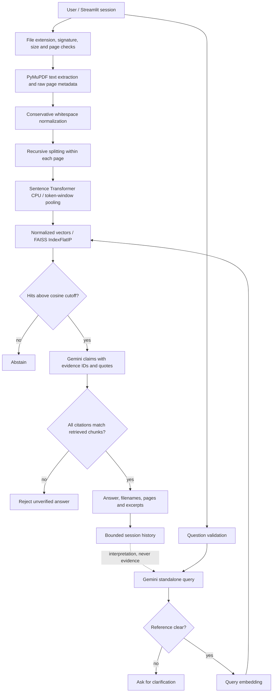

# Architecture

## Boundaries and invariants

`config/settings.py` validates bounded environment values and stores the key as `SecretStr`. Provider-specific behavior lives in `src/llm_service.py`; an `LLM` protocol permits deterministic test doubles. `src/models.py` defines data and response schemas. The pipeline owns one vector store, document dictionary and memory object per session.

`document_loader.py` hashes PDF bytes, extracts original text and attaches a physical, one-based page number. `preprocessing.py` normalizes without stripping financial punctuation. `chunking.py` never crosses page boundaries. Chunk IDs contain the full document digest, page and ordinal. Start offsets refer to normalized page text, not PDF byte offsets.

`embeddings.py` loads public weights once per model name and serializes inference with a lock. It breaks overlength inputs into token windows and averages their embeddings, avoiding silent tail truncation. The store normalizes all vectors and uses inner product as cosine similarity. It validates shape, finite values and nonzero vectors. Adds use a cloned candidate index so failures cannot leave a half-added document.

`rag_pipeline.py` coordinates ingestion, rewriting, retrieval, response validation and memory. Rewriting receives only a bounded history; answering receives no history as evidence. `validate_answer` verifies source membership and whitespace-normalized quote inclusion. It rejects all claims if any evidence reference is invalid. It does not prove entailment, independently verify arithmetic or guarantee that all relevant conflicts were retrieved.

## Data lifecycle

Uploaded PDF bytes are temporarily held by the Streamlit uploader; raw extracted text, normalized chunks and embeddings remain in session memory. They are not written to disk. Neither private text nor embeddings are cached globally. Model weights reside in `.cache/models/` under the project; package/model downloads need network access once. Delete that cache while the app is stopped to reclaim weight storage; no uploaded documents are kept there. No pickle or serialized FAISS index is loaded. Clear controls reset the corresponding session structures. The archive includes only allowlisted source, original samples and verification artifacts.

## Failure behavior

Invalid PDFs are rejected individually, leaving other successful uploads usable. Empty/scanned PDFs request OCR. Partial blank pages produce warnings. Embedding failures leave previously indexed data intact. Missing keys and provider failures use sanitized messages and do not add successful chat turns. Low relevance abstains without an answer-generation call. No collection means the chat input is disabled; the pipeline also checks this invariant independently.
